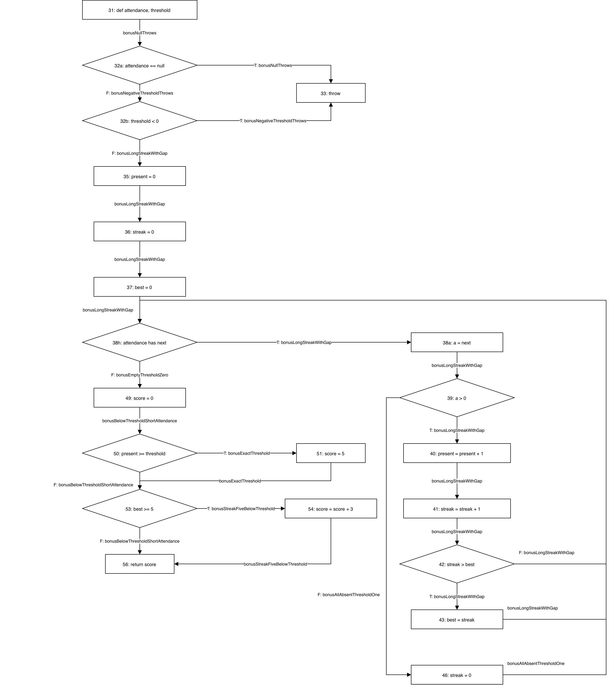

# Лаб 10: Өгөгдлийн урсгалын тест (Definition-Use хосууд)

Нэр: Сайнзаяа
Оюутны код: B252270209

## Орчин

`java -version` ба `mvn -version` гаралт (`results/env-versions.txt`):

```
openjdk version "25.0.2" 2026-01-20 LTS
OpenJDK Runtime Environment Temurin-25.0.2+10 (build 25.0.2+10-LTS)
OpenJDK 64-Bit Server VM Temurin-25.0.2+10 (build 25.0.2+10-LTS, mixed mode, sharing)
WARNING: A restricted method in java.lang.System has been called
WARNING: java.lang.System::load has been called by org.fusesource.jansi.internal.JansiLoader in an unnamed module (file:/Users/tselmuunzaya/tools/apache-maven-3.9.9/lib/jansi-2.4.1.jar)
WARNING: Use --enable-native-access=ALL-UNNAMED to avoid a warning for callers in this module
WARNING: Restricted methods will be blocked in a future release unless native access is enabled

Apache Maven 3.9.9 (8e8579a9e76f7d015ee5ec7bfcdc97d260186937)
Maven home: /Users/tselmuunzaya/tools/apache-maven-3.9.9
Java version: 25.0.2, vendor: Eclipse Adoptium, runtime: /Library/Java/JavaVirtualMachines/temurin-25.jdk/Contents/Home
Default locale: en_MN, platform encoding: UTF-8
OS name: "mac os x", version: "26.5.2", arch: "aarch64", family: "mac"
```

## Тестүүдийн ID

| ID | Тестийн метод | Оролт → гаралт |
|---|---|---|
| T1 | `GcdTest.gcdTwoIterations` | gcd(12,8) = 4 |
| T2 | `GcdTest.gcdYZero` | gcd(7,0) = 7 |
| T3 | `GcdTest.gcdXZero` | gcd(0,5) = 5 |
| D1 | `BonusTest.bonusLongStreakWithGap` | [1,1,1,1,1,0,1], 3 → 8 |
| D2 | `BonusTest.bonusBelowThresholdShortAttendance` | [1], 2 → 0 |
| P1 | `BonusTest.bonusNullThrows` | null, 1 → IllegalArgumentException |
| P2 | `BonusTest.bonusNegativeThresholdThrows` | [1], -1 → IllegalArgumentException |
| P3 | `BonusTest.bonusEmptyThresholdZero` | [], 0 → 5 |
| P4 | `BonusTest.bonusAllAbsentThresholdOne` | [0,0,0], 1 → 0 |
| P5 | `BonusTest.bonusStreakFiveBelowThreshold` | [1,1,1,1,1], 6 → 3 |
| P6 | `BonusTest.bonusExactThreshold` | [1], 1 → 5 |
| K | `BonusTest.bonusBestAfterGap` | [1,1,0,1,1,1], 5 → 5 (M2-ийг унагана) |

D1, D2 нь ALL-DEFS, D1, D2, P1-P6 нь ALL-DU-PAIRS. Тест бүрийн `@DisplayName`-д хамарсан DU хосын дугаар бичигдсэн.

## A: gcd

Лекцийн слайдын дугаар → файлын мөр: 1 → 13, 3 → 15, 4 → 16, 5 → 17, 6 → 18, 8 → 20.

Def/use: мөр 13 def x, y; мөр 15 p-use y; мөр 16 c-use x, y, def tmp; мөр 17 c-use y, def x; мөр 18 c-use tmp, def y; мөр 20 c-use x. Мөр 14 (`int tmp;`) def биш.

| Хувьсагч | Def | Use | Төрөл | Def-clear зам | Тест | Хамрагдсан |
|---|---|---|---|---|---|---|
| x | 13 | 16 | c | 13→15→16 | T1, T3 | ✓ |
| x | 13 | 20 | c | 13→15→20 | T2 | ✓ |
| x | 17 | 16 | c | 17→18→15→16 | T1 | ✓ |
| x | 17 | 20 | c | 17→18→15→20 | T1, T3 | ✓ |
| y | 13 | 15 (T) | p | 13→15→16 | T1, T3 | ✓ |
| y | 13 | 15 (F) | p | 13→15→20 | T2 | ✓ |
| y | 13 | 16 | c | 13→15→16 | T1, T3 | ✓ |
| y | 13 | 17 | c | 13→15→16→17 | T1, T3 | ✓ |
| y | 18 | 15 (T) | p | 18→15→16 | T1 | ✓ |
| y | 18 | 15 (F) | p | 18→15→20 | T1, T3 | ✓ |
| y | 18 | 16 | c | 18→15→16 | T1 | ✓ |
| y | 18 | 17 | c | 18→15→16→17 | T1 | ✓ |
| tmp | 16 | 18 | c | 16→17→18 | T1, T3 | ✓ |

Нийт 13 DU хос (x: 4, y: 8, tmp: 1). Тестийн гаралт: `results/mvn-verify-gcd.txt` (Tests run: 3), `results/jacoco-gcd.csv`.

- `gcd(7,0)` давталтад орохгүй, тиймээс ГАНЦААРАА x(13,20) ба y(13,15)F хосыг хамардаг.
- `gcd(12,8)` 2 давталт хийдэг (12,8 → 8,4 → 4,0). x(17,16), y(18,15)T, y(18,16), y(18,17) хосууд давталтын 2 дахь удаа шаардагдана.

## B: bonus

### B1: CFG

`cfg-bonus.png`, draw.io дээр зурсан. Зангилаа бүрд мөрийн дугаар, ирмэг бүрд T/F ба тухайн ирмэгийг дайрдаг тестийн метод нэр бичсэн. Давталт (мөр 38) нь `38h` (нөхцөл: attendance-д дараагийн элемент байгаа эсэх, attendance-ийн p-use) ба `38a` (алхам: a-д дараагийн элементийг оноох, a-ийн def) гэж хоёр зангилаа болсон. Мөр 32-ийн `||` нь `32a` ба `32b` хоёр нөхцөл болсон.



### B2: Def/Use жагсаалт

| Мөр | Def | Use |
|---|---|---|
| 31 | attendance, threshold | |
| 32 | | attendance p (`== null`), threshold p (`< 0`) |
| 35, 36, 37 | present, streak, best | |
| 38 | a (давталт бүрт) | attendance p |
| 39 | | a p |
| 40 | present | present c |
| 41 | streak | streak c |
| 42 | | streak p, best p |
| 43 | best | streak c |
| 46 | streak (өмнөх def-ийг алддаг, kill) | |
| 49 | score | |
| 50 | | present p, threshold p |
| 51 | score | |
| 53 | | best p |
| 54 | score | score c |
| 56 | | score c |

### B3: DU хүснэгт

| № | Хувьсагч | Def → Use | Төрөл | Def-clear зам | Тест | Хамрагдсан |
|---|---|---|---|---|---|---|
| 1 | attendance | 31 → 32 (T) | p | 31→32a→33 | P1 | ✓ |
| 2 | attendance | 31 → 32 (F) | p | 31→32a→32b | D1 | ✓ |
| 3 | attendance | 31 → 38 (T) | p | 31→...→37→38h→38a | D1 | ✓ |
| 4 | attendance | 31 → 38 (F) | p | 31→...→37→38h→49 | D1 | ✓ |
| 5 | threshold | 31 → 32 (T) | p | 31→32a→32b→33 | P2 | ✓ |
| 6 | threshold | 31 → 32 (F) | p | 31→32a→32b→35 | D1 | ✓ |
| 7 | threshold | 31 → 50 (T) | p | 31→...→49→50→51 | D1 | ✓ |
| 8 | threshold | 31 → 50 (F) | p | 31→...→49→50→53 | D2 | ✓ |
| 9 | present | 35 → 40 | c | 35→36→37→38h→38a→39→40 | D1 | ✓ |
| 10 | present | 35 → 50 (T) | p | 35→...→38h→49→50→51 | P3 | ✓ |
| 11 | present | 35 → 50 (F) | p | 35→...→38h→49→50→53 | P4 | ✓ |
| 12 | present | 40 → 40 | c | 40→41→42→38h→38a→39→40 | D1 | ✓ |
| 13 | present | 40 → 50 (T) | p | 40→41→42→38h→49→50→51 | D1 | ✓ |
| 14 | present | 40 → 50 (F) | p | 40→41→42→38h→49→50→53 | D2 | ✓ |
| 15 | streak | 36 → 41 | c | 36→37→38h→38a→39→40→41 | D1 | ✓ |
| 16 | streak | 41 → 41 | c | 41→42→38h→38a→39→40→41 | D1 | ✓ |
| 17 | streak | 46 → 41 | c | 46→38h→38a→39→40→41 | D1 | ✓ |
| 18 | streak | 41 → 42 (T) | p | 41→42→43 | D1 | ✓ |
| 19 | streak | 41 → 42 (F) | p | 41→42→38h | D1 | ✓ |
| 20 | streak | 41 → 43 | c | 41→42→43 | D1 | ✓ |
| 21 | best | 37 → 42 (T) | p | 37→38h→38a→39→40→41→42→43 | D1 | ✓ |
| 22 | best | 37 → 42 (F) | p | def-clear зам бий, гэвч биелэхгүй | | биелэшгүй |
| 23 | best | 37 → 53 (T) | p | def-clear зам бий, гэвч биелэхгүй | | биелэшгүй |
| 24 | best | 37 → 53 (F) | p | 37→38h→49→50→53→56 | P3, P4 | ✓ |
| 25 | best | 43 → 42 (T) | p | 43→38h→38a→39→40→41→42→43 | D1 | ✓ |
| 26 | best | 43 → 42 (F) | p | 43→38h→...→42→38h | D1 | ✓ |
| 27 | best | 43 → 53 (T) | p | 43→38h→49→50→53→54 | D1 | ✓ |
| 28 | best | 43 → 53 (F) | p | 43→38h→49→50→53→56 | D2 | ✓ |
| 29 | a | 38 → 39 (T) | p | 38a→39→40 | D1 | ✓ |
| 30 | a | 38 → 39 (F) | p | 38a→39→46 | D1 | ✓ |
| 31 | score | 49 → 54 | c | 49→50→53→54 | P5 | ✓ |
| 32 | score | 49 → 56 | c | 49→50→53→56 | D2 | ✓ |
| 33 | score | 51 → 54 | c | 51→53→54 | D1 | ✓ |
| 34 | score | 51 → 56 | c | 51→53→56 | P6 | ✓ |
| 35 | score | 54 → 56 | c | 54→56 | D1 | ✓ |

Нийт 35 хос, үүнээс 33 нь биелэх, 2 нь биелэшгүй.

**Биелэшгүй хосууд:**
- №22: 37-ийн `best = 0` 42-т хүрэх үед `streak` дөнгөж 41-д нэмэгдсэн тул ≥ 1 байна, `streak > best` үргэлж үнэн, худал салаа боломжгүй.
- №23: 37-ийн def 53-д хүрэхийн тулд 43 хэзээ ч ажиллаагүй байх ёстой, тэгвэл `best = 0` хэвээр, `0 >= 5` үнэн болохгүй.

**Kill (мөр 46):** `streak = 0` нь тухайн замд 36 ба 41-ийн `streak` def-ийг алддаг. Тиймээс №16 хос зөвхөн дараалсан ирсэн өдрүүдэд def-clear. Мөн (36,42), (36,43), (46,42), (46,43) хослол def-clear замгүй: 42 ба 43-д хүрэх бүх зам 41-ийг (дахин def) дайрдаг тул эдгээрийг DU хос гэж тоолоогүй.

### B4: ALL-DEFS ба ALL-DU-PAIRS

**ALL-DEFS: 2 тест (D1, D2).** D1 нь `score`-ийн 49-ийн def-ээс бусад бүх def-ийг use-д хүргэнэ. `score` 49 нь 50 худал үед (present < threshold) л 54/56-д хүрнэ, харин 51 нь 50 үнэн үед л ажиллана (51 нь 49-ийг алддаг). Нэг гүйцэтгэлд 50 хоёулаа байж чадахгүй тул 1 тест хүрэлцэхгүй, 2 хэрэгтэй. D2 нь 49 → 56-г хамарна.

**ALL-DU-PAIRS: 6 тест нэмж нийт 8 тест (D1, D2, P1-P6).** Нэмэлт 6 тест нь №1, 5, 10, 11, 24, 31, 34-г хамарна. Тестийн санаанууд: null, сөрөг threshold, хоосон массив, бүгд тасалсан, 5 удаа ирсэн боловч threshold-оос бага, яг threshold.

### B5: JaCoCo

| Үе шат | Tests run (gcd 3-ыг оруулсан) | Branch (missed / covered) | Line missed | Файл |
|---|---|---|---|---|
| ALL-DEFS | 5 | 2 / 14 | 2 | `mvn-verify-alldefs.txt`, `jacoco-alldefs.csv` |
| ALL-DU-PAIRS | 11 | 0 / 16 | 1 | `mvn-verify-allpairs.txt`, `jacoco-allpairs.csv` |
| Эцсийн (K тест нэмсэн) | 12 | 0 / 16 | 1 | `mvn-verify-final.txt`, `jacoco-final.csv` |

`LINE_MISSED = 1` нь 7-р мөр (`DataFlowTargets` классын далд constructor), хэвийн. ALL-DEFS үед `LINE_MISSED = 2` нь 7-р мөр ба 33-р мөр (`throw`).

**All-defs хангагдсан ч branch 100% биш байж болох уу?** Тийм. `jacoco-alldefs.csv`-д Branch 14/16. all-defs нь def бүрийг ямар нэг use-д хүргэхийг л шаарддаг тул `attendance == null`, `threshold < 0`-ийн үнэн салаа шаардлагагүй, тест тэдгээрийг дайрсангүй.

**Branch 100% болсон мөчид DU хос хамрагдаагүй үлдэж болох уу?** Тийм. D1, D2, P1, P2 дөрвөн тест (+ GcdTest) Branch 16/16 хүргэдэг (`results/jacoco-branch-example.csv`, `results/mvn-verify-branch-example.txt`), гэвч дараах DU хосууд хамрагдаагүй: №10, 11 (present = 0 үед 50-д орох тест байхгүй), №24 (ирсэн өдөр байхгүй үед 53 худал), №31 (present < threshold ба best ≥ 5), №34 (present ≥ threshold ба best < 5). Branch хамралт нь нөхцөл бүрийн үнэн, худал хоёр салааг л хамарсан эсэхийг хэмждэг, def-аас use хүртэлх замыг хэмждэггүй.

## C: Fault seeding

Мутаци бүрийг `DataFlowTargets.java` дээр шууд хийж, `mvn test`-ийн гаралтыг хадгалаад `git restore`-оор буцаасан. Мутацийг commit хийгээгүй, эцсийн `src/main` нь Starter commit-тэй ижил (`git diff 625d266 HEAD -- src/main` хоосон).

| № | Мутаци | Төрөл | Үр дүн | Унасан тест, мөр | Файл |
|---|---|---|---|---|---|
| M1 | мөр 41 `streak = streak + 1` устгасан | Missing update | УНАСАН (11 тест, 2 fail) | `bonusLongStreakWithGap`: expected <8> but was <5>; `bonusStreakFiveBelowThreshold`: expected <3> but was <0> | `results/mvn-test-M1.txt` |
| M2 | мөр 43 `best = streak` → `best = present` | Wrong variable | АМЬД (11 тест ногоон) | байхгүй | `results/mvn-test-M2.txt` |
| M3 | давталтын дараа `int total = present + best;` нэмсэн | Dead definition | АМЬД (12 тест ногоон) | байхгүй | `results/mvn-test-M3.txt` |

### M2: ALL-DU-PAIRS давж амьд үлдсэн яагаад

Бүх 33 биелэх DU хос хамрагдсан атал M2 баригдсангүй. Учир нь `best` шинэчлэгдэх мөчид (мөр 43) бүх тестэд `present == streak` байсан: D1-д 1-5-р өдөр (`present` ба `streak` 1,2,3,4,5), P5, P6-д мөн адил. Тасалсан өдрийн ДАРАА `best` шинэчлэгдэх тест байхгүй тул `present`, `streak` хоёр ялгарсангүй. DU хос нь def-аас use хүртэл def-clear зам дайрсан эсэхийг л шалгадаг, use-ийн хувьсагч утгаараа зөв эсэхийг шалгадаггүй.

Унагах тест нэмсэн (`K`): `bonusBestAfterGap`, [1,1,0,1,1,1], threshold 5. Мөр 43 ажиллах үед `present = 5`, `streak = 3` ялгарна. Анхны код 5 буцаана (best = 3 < 5), M2 дээр `best = 5` болж 8 гарна. Мутаци хийгээд ажиллуулахад `bonusBestAfterGap: expected <5> but was <8>`, 12 тестээс 1 нь унасан (`results/mvn-test-M2-kill.txt`).

### M3: яагаад ямар ч тест унагадаггүй

`total` нь тодорхойлогдсон боловч хаана ч хэрэглэгдэхгүй, буцаах утга болон бусад хувьсагчид нөлөөлөхгүй. Тест зөвхөн `bonus()`-ийн буцаах утгыг шалгадаг тул хэзээ ч ялгаж чадахгүй. `javac` ч анхааруулдаггүй. Үүнийг static analysis багаж (IDE-ийн inspection, SpotBugs `DLS_DEAD_LOCAL_STORE`, PMD `UnusedLocalVariable`) барих ёстой. VS Code (Java өргөтгөл) дээрх анхааруулга:

> The value of the local variable total is not used Java(536870973)

DU хүснэгтийн үүднээс ч энэ def-д use байхгүй тул түүнийг all-defs хангах боломжгүй, хүснэгтэд нэг ч хос байхгүй.

## Дүгнэлт

DU анализ нь branch хамралтаас давуу тал нь хувьсагчийн утга хаанаас хаашаа урсаж буйг шалгадагт оршино. Тиймээс branch 100% байхад ч үл үзэгдэх алдааг (M1: дутуу шинэчлэл) илрүүлдэг. Branch 16/16 хүртэл 4 тест хангалттай байсан боловч тэр үед 5 DU хос хамрагдаагүй үлдсэн. Харин DU анализ нь үнэтэй: нэг `bonus()` функцэд 35 хос, 2 биелэшгүй хос, kill шинжилгээг гараар хийх хэрэгтэй, JaCoCo үүнийг хэмждэггүй. Бүх биелэх DU хос хамрагдсан ч M2 (буруу хувьсагч) амьд үлдсэн, учир нь хос нь use-ийн утгыг шалгадаггүй. Түүнийг унагахад тасалсны дараа `present` ба `streak` ялгарах нэмэлт тест хэрэгтэй болсон. M3 (үхсэн def)-ийг тест ерөөсөө барьж чадахгүй, static analysis л барина. Иймээс branch хамралт, DU хамралт, static analysis гурав бие биеийгээ нөхдөг. Хамгийн их цаг авсан алхам нь bonus()-ийн CFG-г гараар зурах байсан: 21 зангилаа, 26 ирмэг бүрд мөрийн дугаар, тестийн нэр бичиж, шошгууд давхцахгүй болтол дахин засах хэрэгтэй болсон.

## AI ашигласан тухай

Энэ лабд Claude (Anthropic) AI туслахыг ашигласан:
- gcd ба bonus-ийн DU хүснэгтийн анхны хувилбарыг гаргасан (хосуудыг скриптээр баталгаажуулсан), тестийн кодын эхний хувилбар (GcdTest, BonusTest)
- M2-ийг унагах тестийн санааг (тасалсны дараах урт цуваа) тайлбарлахад тусалсан.
- bonus()-ийн CFG-г AI тусламжтайгаар хийсэн.

Бүх `mvn` / JaCoCo гаралт, csv файлууд, мутацийн үр дүн өөрийн компьютер дээр бодитоор ажиллаж гарсан.

## Ажиллуулах

```
mvn verify
```

JaCoCo тайлан: `target/site/jacoco/index.html`, тоо: `target/site/jacoco/jacoco.csv`.
